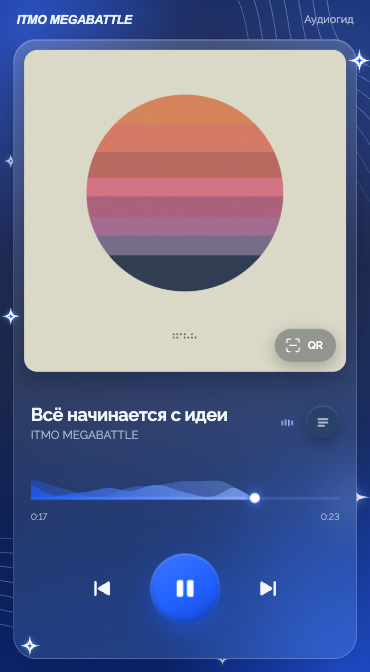

# MEGA / Аудиогид выставки

Мобильный аудиогид ITMO MEGABATTLE: плеер с обложкой и рассказом, непрерывный звуковой фон и встроенный QR-сканер. Посетитель сканирует QR у экспоната камерой телефона, открывается плеер с нужной обложкой и записью. Следующие экспонаты он сканирует кнопкой внутри плеера, и фон при этом не прерывается. Вручную переключать истории нельзя: кнопки «назад» и «вперёд» тоже открывают сканер, а если закрыть его без скана, продолжает играть текущая запись.



## Запуск

```sh
npm install
npm run dev        # dev-сервер, доступен и по локальной сети
npm run build      # сборка в dist/
npm run preview    # просмотр сборки
```

Живой сканер камеры в браузере работает только по HTTPS (или на localhost). Для проверки на телефоне нужен HTTPS-туннель или хостинг.

## Треки

Всё содержимое задаётся в `public/config.json`. Приложение загружает его при открытии, поэтому на хостинге конфиг можно править без пересборки:

```json
{
  "siteUrl": "https://imb-special.ru",
  "ambient": "audio/ambient.wav",
  "ambientVolume": 0.22,
  "tracks": [
    {
      "id": "01", "title": "…", "artist": "…",
      "audio": "audio/01.m4a", "cover": "covers/01.jpg", "qr": "qr/01.png",
      "transcript": "<h3>Заголовок</h3><p>Текст рассказа, <b>жирный</b>, <i>курсив</i>,<br>перенос строки.</p>"
    }
  ]
}
```

`ambientVolume` — громкость фоновой дорожки относительно рассказа, от `0` до `1` (по умолчанию `0.22`). На iPhone громкость задают только кнопки телефона, и iOS не даёт сайтам менять её программно. Поэтому там фон звучит с той же громкостью, что и рассказ, и уровень надо закладывать в сам файл `ambient`.

`transcript` необязателен. Если он есть, рядом с названием появляется кнопка, открывающая текст на весь экран. Это HTML, который вставляется как есть; для оформления подходят `p`, `br`, `b`, `i`, `h1`–`h4`. Кавычки внутри HTML в JSON экранируйте (`\"`).

Пути указываются относительно `public/`. Чтобы добавить трек:

1. Положите `public/audio/05.m4a` (или MP3) и `public/covers/05.jpg` (квадрат).
2. Добавьте запись в `tracks`.
3. Выполните `npm run qr` — появится `public/qr/05.png`.

Сразу после открытия плеер по очереди загружает в память все обложки, а затем все записи из конфига. Переключения и сканы в пределах визита не ждут сети. Учитывайте суммарный размер файлов: их скачивает каждый посетитель. Обложки достаточно делать 800×800.

`id` попадает в QR-ссылку (`<siteUrl>/?t=05`). Не меняйте его у уже напечатанных кодов.

## QR-коды

`npm run qr` генерирует PNG для всех треков по адресу `siteUrl` и предупреждает об отсутствующих аудио и обложках. Встроенный сканер принимает только ссылки с адреса `siteUrl` или с текущего адреса страницы.

## Деплой под https (imb-special.ru)

Два контейнера в `docker-compose.yml`:
- `guide` — nginx без root-прав, раздаёт собранный сайт. Слушает только `127.0.0.1:3300`, снаружи по голому http его не достать.
- `caddy` — сам получает и продлевает сертификат Let's Encrypt, редиректит http → https, сжимает JS/CSS/JSON и WebAssembly сканера (947 → 424 КБ).

Папка `public/` подключена в контейнер с сервера. Правки `config.json`, аудио, обложек и QR видны сразу, без пересборки образа. Пересобирать нужно только после изменений в коде (`src/`, `index.html`).

1. Направить A-запись `imb-special.ru` на сервер. Открыть на фаерволе 80 и 443.
2. Поднять приложение:

   ```bash
   git clone <repo> audioguide && cd audioguide
   cp .env.example .env              # GUIDE_DOMAIN=imb-special.ru
   docker compose up -d --build
   curl -s localhost:3300/health     # ok
   ```

3. Проверить `https://imb-special.ru`. Сертификат выпускается при первом запуске, это занимает несколько секунд. После проверки можно включить HSTS: раскомментировать строку в `deploy/Caddyfile` и выполнить `docker compose restart caddy`.

`siteUrl` в `public/config.json` должен совпадать с доменом: из него строятся QR-коды. Сейчас там `https://imb-special.ru`, коды в `public/qr/` сгенерированы под него. Если домен поменяется, исправьте `siteUrl` и выполните `npm run qr`, а напечатанные коды перепечатайте.

**Если на сервере уже есть nginx на 80/443**, Caddy не нужен. Запустите только приложение командой `docker compose up -d --build guide`. Затем выпустите сертификат командой `certbot --nginx -d imb-special.ru` и подключите `deploy/nginx.conf` в `sites-enabled`.

Логи и состояние:

```bash
docker compose ps                 # healthcheck раз в 30 секунд ходит в /health
docker compose logs -f caddy      # выпуск сертификата и ошибки TLS
docker compose logs -f guide      # запросы к файлам
```

Как отдаётся контент:
- файлы сборки (`/assets/*`, в имени хеш) кэшируются навсегда;
- `config.json`, аудио, обложки и QR каждый раз сверяются с сервером по ETag: правки доходят до посетителей сразу, а неизменённые файлы отвечают коротким 304;
- аудио отдаётся частями (HTTP Range) — без этого не работает перемотка в Safari.

## Материалы

`public/audio/01–04.m4a` и `ambient.wav` — демозаписи. Обложки в `public/covers/` — временные визуальные референсы, права принадлежат правообладателям: Tycho — Awake, Kiasmos — Kiasmos, Jon Hopkins — Immunity, Bonobo — Migration.
